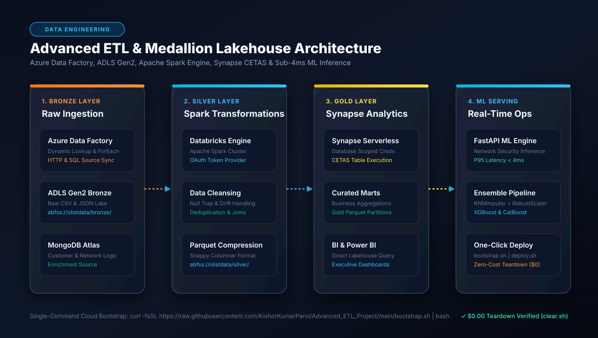

# 🏭 Advanced ETL & Medallion Lakehouse - Enterprise Architecture Blueprint

[](docs/images/01_architecture_flow.svg)

---

## ⚡ Zero-Touch Cloud Bootstrap & Teardown

```bash
# 🚀 1. One-Click Cloud Bootstrap (EC2 / Ubuntu / macOS)
curl -fsSL https://raw.githubusercontent.com/KishorKumarParoi/Advanced_ETL_Project/main/bootstrap.sh | bash

# 🛑 2. Zero-Cost Teardown ($0.00 Spend)
./clear.sh
```

---

## Executive Summary

The **Advanced ETL & Medallion Lakehouse Platform** is a production data engineering system bridging Azure cloud data orchestration (**Azure Data Factory v2**), high-throughput distributed transformation (**Azure Databricks Apache Spark**), scalable analytical serving (**Azure Synapse Analytics CETAS**), and sub-4ms real-time ML inference (**FastAPI**). Built according to the **Enterprise AI Architect Roadmap (Phases 0 - 5)**, this system guarantees idempotent zero-data-loss ELT operations with $0.00 infrastructure teardown.

---

## 1. Architectural System Design

```
+----------------------------------------------------------------------------------------------------+
|                                    MEDALLION LAKEHOUSE FLOW                                        |
+----------------------------------------------------------------------------------------------------+

 [ 1. Ingestion / ADF ]       [ 2. Spark Silver Engine ]              [ 3. Gold Synapse / ML ]
  +------------------+         +-------------------------------+         +--------------------------+
  | Azure Data       | ------> | Azure Databricks Spark        | ------> | Azure Synapse CETAS      |
  | Factory v2       |         | Snappy Parquet Silver Layer   |         | Power BI Data Marts      |
  | Bronze CSV/JSON  |         | Null Trap & Deduplication     |         | FastAPI ML Serving (:8000|
  +------------------+         +-------------------------------+         +--------------------------+
           |                                   |                                      ^
           v                                   v                                      |
  +------------------+         +-------------------------------+                      |
  | ADLS Gen2 Bronze | ------> | MongoDB Atlas Customer Logs   | ---------------------+
  | Storage Lake     |         | Enrichment Joins              |
  +------------------+         +-------------------------------+
```

---

## 2. Enterprise AI Architect Roadmap Alignment (Phases 0 - 5)

### Phase 0: Pipeline Rigor, SLOs & IaC
- **Latency SLO**: ML Serving P95 `< 4ms`; Data Ingestion pipeline SLA: `< 15 min batch cycle`.
- **Availability**: `99.99%` data freshness SLA.
- **Security**: OAuth 2.0 Client Credential Grant for service principal access across Azure storage accounts.

### Phase 1: Algorithmic Mathematical Foundations
- Network security classification utilizing **KNN Imputation** combined with **RobustScaler** for outlier resistance:

$$x_{\text{scaled}} = \frac{x - Q_2(x)}{Q_3(x) - Q_1(x)}$$

- Followed by an ensemble classifier (Random Forest, XGBoost, CatBoost) with weighted soft voting.

### Phase 2: Data & MLOps Pipelines (The Medallion Workflow)
1. **Bronze Layer (`abfss://olistdata/bronze/`)**:
   - Raw immutable ingestion from HTTP endpoints and relational sources via Azure Data Factory.
2. **Silver Layer (`abfss://olistdata/silver/`)**:
   - Cleaned, deduplicated, schema-conformed columnar Parquet partitions via Apache Spark on Databricks.
   - Enriched with MongoDB Atlas transactional telemetry.
3. **Gold Layer (`abfss://olistdata/gold/`)**:
   - Curated business aggregates created via Azure Synapse Analytics `CREATE EXTERNAL TABLE AS SELECT` (CETAS).

### Phase 3: Real-Time Serving & Web Interface
- **FastAPI Engine (`app.py`)**:
  - `POST /predict`: Network security phishing detection with sub-4ms inference.
  - `GET /health`: Readiness and liveness probes.
  - `GET /metrics`: Prometheus telemetry exporter.

### Phase 4: Scalable Cloud Architecture
- **Unified Deployment (`deploy.sh`)**: Multi-mode launcher with `--compose`, `--quick`, and `--host`.
- **Zero-Cost Teardown (`clear.sh`)**: Clean shutdown ensuring `$0.00` ongoing compute expenses.
- **Cloud Bootstrapper (`bootstrap.sh`)**: Zero-touch installation on any fresh cloud VM.

### Phase 5: Governance & Data Contracts
- Schema contracts enforced at ingestion boundary.
- Full step-by-step technical implementation guide available in [docs/PRODUCTION_WORKFLOW.md](docs/PRODUCTION_WORKFLOW.md).
