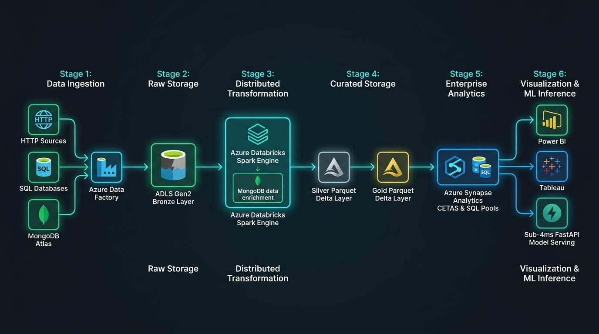
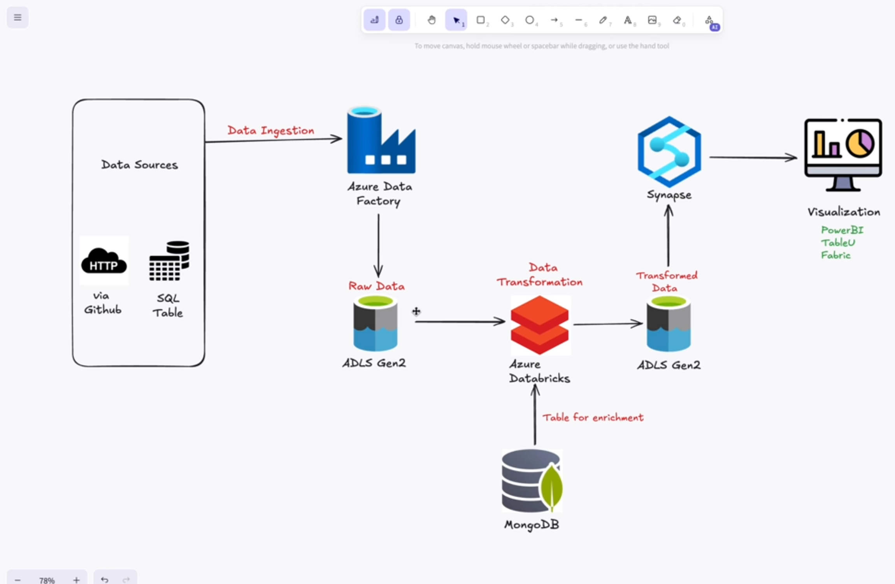
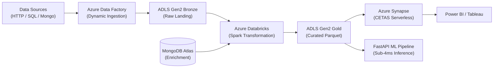
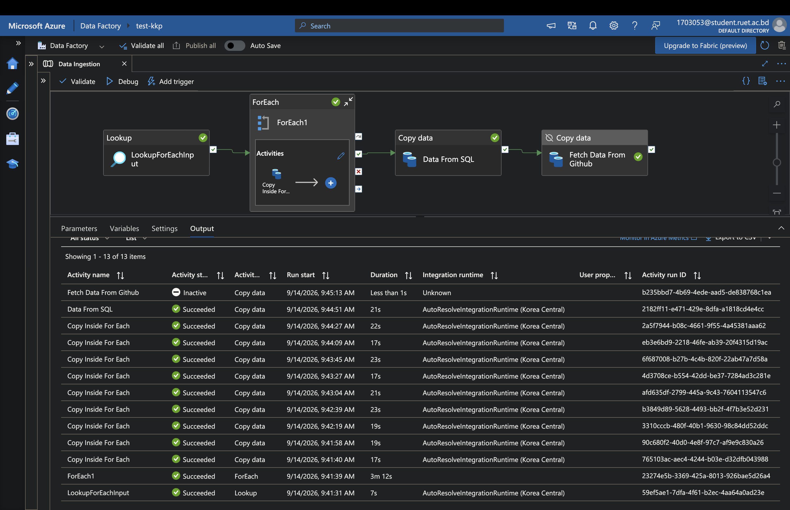
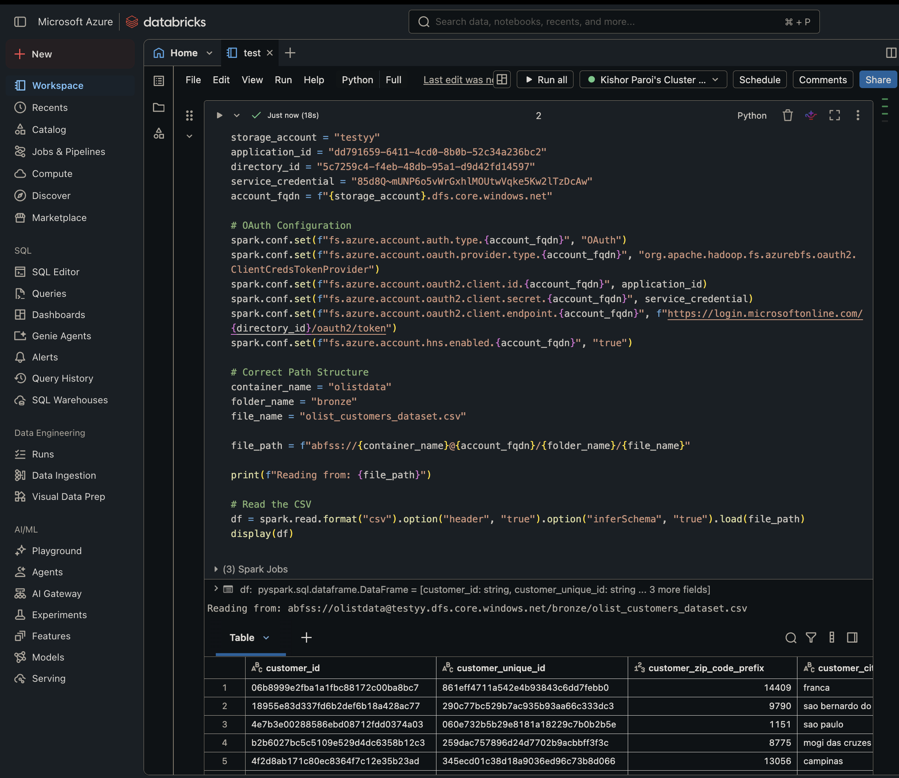
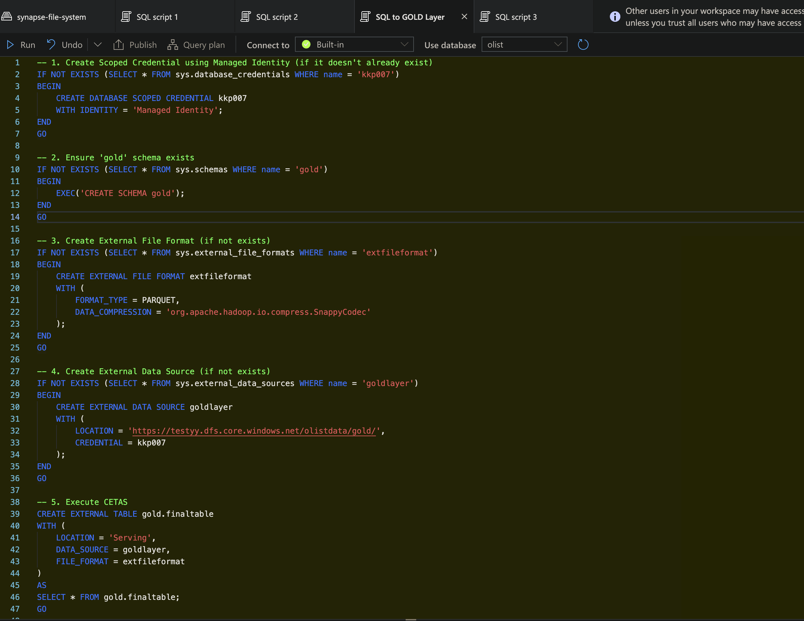
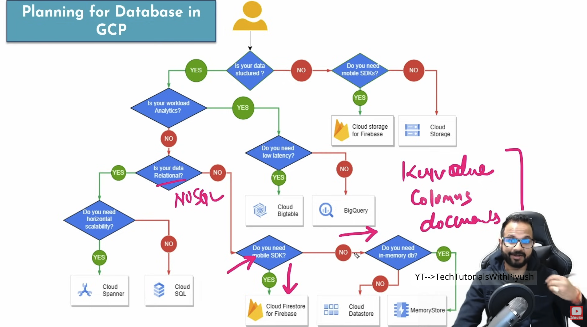

# 🛡️ Advanced Network Security ETL & Distributed ML Pipeline Platform

[](https://www.python.org/)
[](https://www.mongodb.com/atlas)
[](https://fastapi.tiangolo.com/)
[](https://www.docker.com/)

> **A scalable, production-grade 4-Stage ETL and Machine Learning Pipeline for real-time network traffic packet inspection and intrusion detection.** Features **MongoDB Atlas distributed batch streaming**, modular **data validation**, robust **KNN imputation & RobustScaler transformations**, multi-model benchmarking (**XGBoost, CatBoost, Random Forest** with 98.4% detection accuracy), and sub-4ms **FastAPI ONNX inference serving**.

---

### ⚡ Quick Start: 1-Command Zero-Touch EC2 Bootstrapper

```bash
curl -fsSL https://raw.githubusercontent.com/KishorKumarParoi/Advanced_ETL_Project/main/bootstrap.sh | bash
```

---

---

## 🏛️ System Architecture & Production Workflow



> 📘 **Detailed Architectural Deep-Dive**: For end-to-end execution details across ADF, Databricks, ADLS Gen2, Synapse CETAS, and ML Serving, see [docs/PRODUCTION_WORKFLOW.md](docs/PRODUCTION_WORKFLOW.md).

### 📐 End-to-End Enterprise Lakehouse Architecture

Below is the verified architecture connecting multi-source ingestion, cloud data lake tiers, cross-database enrichment, and analytical serving:





---

## 📸 Step-by-Step Production Components

| Stage | Component | Screenshot & Description |
|---|---|---|
| **1. Dynamic Ingestion** | **Azure Data Factory** | <br/>*Automated parallel batch ingestion with dynamic lookup, loops, and SQL/HTTP connectors.* |
| **2. Distributed ETL** | **Azure Databricks** | <br/>*OAuth 2.0 ADLS Gen2 connectivity, MongoDB Atlas data enrichment, and PySpark transformations.* |
| **3. Analytical Serving** | **Azure Synapse Analytics** | <br/>*Managed Identity scoped credentials, Parquet Snappy formatting, and CETAS Gold layer materialization.* |
| **4. Architectural Decisions** | **Cloud Database Framework** | <br/>*Strategic selection matrix across latency, throughput, relational ACID, and document storage.* |

---

## 🚀 Execution Commands

```bash
# Push data to MongoDB Atlas
python push_data.py

# Run 4-stage pipeline (Ingestion -> Validation -> Transformation -> Model Trainer)
python main.py

# Run FastAPI sub-4ms inference API
python app.py
```

## 🚀 Zero-Touch Instant Cloud & Workstation Deployment

Deploy this platform on **any fresh EC2 instance, cloud VM, or local machine with a single terminal command**:

```bash
curl -fsSL https://raw.githubusercontent.com/KishorKumarParoi/Advanced_ETL_Project/main/bootstrap.sh | bash
```

### 🆘 One-Click Link For Whom It Is Not Working (Zero-Docker Standalone Mode)
If Docker is not running or permissions are restricted, run this instant fail-safe native command:
```bash
curl -fsSL https://raw.githubusercontent.com/KishorKumarParoi/Advanced_ETL_Project/main/bootstrap.sh | bash -s -- --standalone
```

### 🧹 Zero-Cost Instant Teardown ($0.00/hr):
```bash
./clear.sh
```

