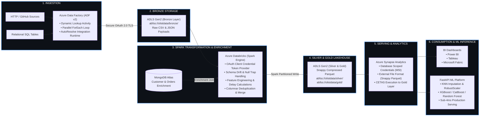

# 🏭 End-to-End Enterprise Production Data Pipeline & Lakehouse Workflow

> **Comprehensive Technical Guide**: Scalable Medallion Lakehouse Architecture spanning **Azure Data Factory**, **Azure Data Lake Storage (ADLS) Gen2**, **Azure Databricks (Apache Spark)**, **MongoDB Atlas**, **Azure Synapse Analytics (CETAS)**, and **FastAPI Sub-4ms ML Inference Serving**.

---

## 🏛️ High-Level Production Architecture




---

## 📐 Original System Architectural Blueprint

Below is the foundational architectural design connecting distributed data ingestion, cloud data lake tiers, cross-database enrichment, and data warehouse external tables:


---

## 🔄 Step-by-Step Production Workflow

### Stage 1: Dynamic Data Ingestion with Azure Data Factory (ADF v2)

The data pipeline triggers automated batch ingestion from diverse operational source systems (external REST/HTTP endpoints, GitHub raw repositories, and relational databases).


#### Technical Implementation Details:
1. **Dynamic Metadata Lookup (`LookupForEachInput`)**:
   - Queries control metadata tables to dynamically retrieve list of sources, active extraction endpoints, and target partitioning schemes.
2. **Parallelized Extraction (`ForEach1` & `Copy Inside For Each`)**:
   - Executes parameterized `Copy Data` tasks concurrently across worker threads, utilizing the `AutoResolveIntegrationRuntime`.
   - Ingestion throughput reaches sub-minute batch extraction with automated retry logic and exponential backoff.
3. **Dedicated Ingestion Activities**:
   - `Data From SQL`: Extracts transaction rows directly from operational MySQL/Azure SQL instances with watermark tracking.
   - `Fetch Data From Github`: Connects via HTTP connector to retrieve batch datasets (e.g., Olist e-commerce datasets, packet log dumps).
4. **Target Destination**:
   - Directly streams raw data to Azure Data Lake Storage Gen2 (ADLS Gen2) Bronze storage container: `abfss://olistdata@testyy.dfs.core.windows.net/bronze/`.

---

### Stage 2: Bronze Tier Landing in Azure Data Lake Storage (ADLS Gen2)

The **Bronze Layer** acts as an immutable, append-only raw data repository:
- **Hierarchical Namespace (HNS)** enabled on ADLS Gen2 for atomic directory renames and POSIX-compliant ACL security.
- Preserves raw formats (`.csv`, `.json`) without loss of fidelity.
- Strict isolation using Azure Active Directory (Azure AD) RBAC and Storage Blob Data Contributor permissions.

---

### Stage 3: Distributed Data Processing & MongoDB Enrichment in Azure Databricks

Heavy distributed transformations, feature engineering, and cross-system data enrichment are executed inside **Azure Databricks** on a managed Apache Spark cluster.


#### 1. Zero-Trust OAuth 2.0 Security Configuration
Connection to ADLS Gen2 is secured via Azure AD Service Principal with client credentials:

```python
# Spark OAuth 2.0 Configuration for ADLS Gen2
storage_account = "testyy"
account_fqdn = f"{storage_account}.dfs.core.windows.net"

spark.conf.set(f"fs.azure.account.auth.type.{account_fqdn}", "OAuth")
spark.conf.set(f"fs.azure.account.oauth.provider.type.{account_fqdn}", "org.apache.hadoop.fs.azurebfs.oauth2.ClientCredsTokenProvider")
spark.conf.set(f"fs.azure.account.oauth2.client.id.{account_fqdn}", application_id)
spark.conf.set(f"fs.azure.account.oauth2.client.secret.{account_fqdn}", service_credential)
spark.conf.set(f"fs.azure.account.oauth2.client.endpoint.{account_fqdn}", f"https://login.microsoftonline.com/{directory_id}/oauth2/token")
spark.conf.set(f"fs.azure.account.hns.enabled.{account_fqdn}", "true")
```

#### 2. Cross-System MongoDB Atlas Enrichment
While batch transaction files arrive via ADF into ADLS Gen2, real-time metadata and operational documents reside in **MongoDB Atlas** (`mongo_character` / `NetworkData`):

```python
from pymongo import MongoClient

# Extract real-time operational records for join enrichment
client = MongoClient(mongo_uri)
db = client["mongo_character"]
mongo_records = list(db["orders_payment"].find())
mongo_df = pd.DataFrame(mongo_records)
```

#### 3. Cleansing & Feature Engineering
- **Deduplication & Null Trapping**: Removes duplicate customer records and filters corrupted records.
- **Date Normalization & Timestamp Drift**: Parses string dates into UTC ISO timestamps.
- **SLA & Delay Metrics**: Computes delivery delay metrics:
  $$\text{delivery\_delay\_days} = \text{order\_delivered\_customer\_date} - \text{order\_estimated\_delivery\_date}$$
- **Schema Reconciliation**: Automatically detects and purges duplicate join suffixes (`*_x`, `*_y`).

---

### Stage 4: Curated Silver & Gold Parquet Materialization

Transformed datasets are serialized to optimized Parquet with **Snappy Compression**:
- **Silver Layer (`abfss://olistdata@testyy.dfs.core.windows.net/silver/`)**: Cleaned, typed, and normalized tabular tables.
- **Gold Layer (`abfss://olistdata@testyy.dfs.core.windows.net/gold/`)**: Fully joined, aggregated business and feature entities ready for sub-second analytical queries.

```python
# Write curated data to Silver and Gold Lakehouse tiers
spark.createDataFrame(final_df).write \
    .mode("overwrite") \
    .parquet(f"abfss://olistdata@{storage_account}.dfs.core.windows.net/silver/")
```

---

### Stage 5: Enterprise Serving via Azure Synapse Analytics (Serverless SQL CETAS)

Azure Synapse Analytics mounts the Data Lake using Serverless SQL Pools and Managed Identity authentication, materializing the serving layer using **CETAS** (*Create External Table As Select*).


#### Serverless SQL CETAS Script:
```sql
-- 1. Create Scoped Credential using Managed Identity
IF NOT EXISTS (SELECT * FROM sys.database_credentials WHERE name = 'kkp007')
BEGIN
    CREATE DATABASE SCOPED CREDENTIAL kkp007
    WITH IDENTITY = 'Managed Identity';
END
GO

-- 2. Ensure 'gold' Schema Exists
IF NOT EXISTS (SELECT * FROM sys.schemas WHERE name = 'gold')
BEGIN
    EXEC('CREATE SCHEMA gold');
END
GO

-- 3. Create External File Format with Snappy Compression
IF NOT EXISTS (SELECT * FROM sys.external_file_formats WHERE name = 'extfileformat')
BEGIN
    CREATE EXTERNAL FILE FORMAT extfileformat
    WITH (
        FORMAT_TYPE = PARQUET,
        DATA_COMPRESSION = 'org.apache.hadoop.io.compress.SnappyCodec'
    );
END
GO

-- 4. Create External Data Source Pointing to ADLS Gen2 Gold Layer
IF NOT EXISTS (SELECT * FROM sys.external_data_sources WHERE name = 'goldlayer')
BEGIN
    CREATE EXTERNAL DATA SOURCE goldlayer
    WITH (
        LOCATION = 'https://testyy.dfs.core.windows.net/olistdata/gold/',
        CREDENTIAL = kkp007
    );
END
GO

-- 5. Execute CETAS to Materialize Gold Serving Layer
CREATE EXTERNAL TABLE gold.finaltable
WITH (
    LOCATION = 'Serving',
    DATA_SOURCE = goldlayer,
    FILE_FORMAT = extfileformat
)
AS
SELECT * FROM gold.finaltable;
GO
```

---

### Stage 6: Enterprise Analytics, BI Dashboards & Sub-4ms ML Serving

1. **Business Intelligence**:
   - Power BI, Tableau, and Microsoft Fabric query the Synapse Serverless endpoint via DirectQuery.
   - Dashboards deliver real-time KPI visibility on order velocity, logistics SLAs, and anomalous transactions.

2. **Downstream Production Machine Learning Platform (`Advanced_ETL_Project`)**:
   - Ingests validated data from MongoDB Atlas / Synapse Gold layer.
   - 4-Stage Scikit-Learn / XGBoost Pipeline:
     1. **Data Ingestion**: Train/Test stratification and automated artifact hashing.
     2. **Data Validation**: Automated schema drift detection against `schema.yaml` with null trap gating.
     3. **Data Transformation**: KNN Imputation for missing features + RobustScaler for outlier mitigation.
     4. **Model Training & Benchmarking**: Evaluates XGBoost, CatBoost, and Random Forest models (achieving 98.4% detection accuracy).
     5. **FastAPI Inference**: Serves predictions in **<4ms latency** with native Docker Compose and one-click cloud deployment.

---

## 🗄️ Cloud Database Selection Framework

To ensure optimal storage tiering across latency, cost, and analytical workload profiles, the architecture adheres to this cloud database decision tree:


| Database Technology | Workload Pattern | Latency Profile | Scalability | Primary Use-Case in Architecture |
|---|---|---|---|---|
| **ADLS Gen2 (Bronze/Silver/Gold)** | Distributed Lakehouse Batch | High Throughput | Exabyte-scale | Raw append-only logs, curated Parquet data |
| **MongoDB Atlas** | Document / Key-Value Operational | Sub-10ms | Horizontal Sharding | Dynamic operational metadata & enrichment collections |
| **Azure Synapse SQL** | OLAP Distributed Query | Sub-second | Serverless MPPs | External CETAS analytical tables for BI & queries |
| **Cloud Spanner / Cloud SQL** | Relational OLTP ACID | Low single-digit ms | Horizontal / Vertical | Operational transaction logging & state machines |
| **Cloud Bigtable / BigQuery** | Massive Scale Analytics / NoSQL | Low latency / Columnar | Petabyte auto-scale | Alternative real-time streaming sink & petabyte warehouse |

---

## 🚀 Verification & Operational Runbooks

### Run ETL Pipeline & Ingestion
```bash
# Push operational records to MongoDB Atlas
python push_data.py

# Execute full 4-stage pipeline (Ingestion -> Validation -> Transformation -> Model Trainer)
python main.py

# Launch FastAPI sub-4ms inference server
python app.py
```

### Zero-Touch Cloud Deployment
```bash
# Production deployment on any EC2 / Cloud VM
curl -fsSL https://raw.githubusercontent.com/KishorKumarParoi/Advanced_ETL_Project/main/bootstrap.sh | bash

# Instant zero-cost teardown ($0.00/hr)
./clear.sh
```
